# Lyra Lyrics

**Une petite fenêtre toujours au-dessus qui affiche, sur ton Mac, les paroles synchronisées du morceau en cours dans Spotify ou Apple Music.**

*[English](README.md) · Français*

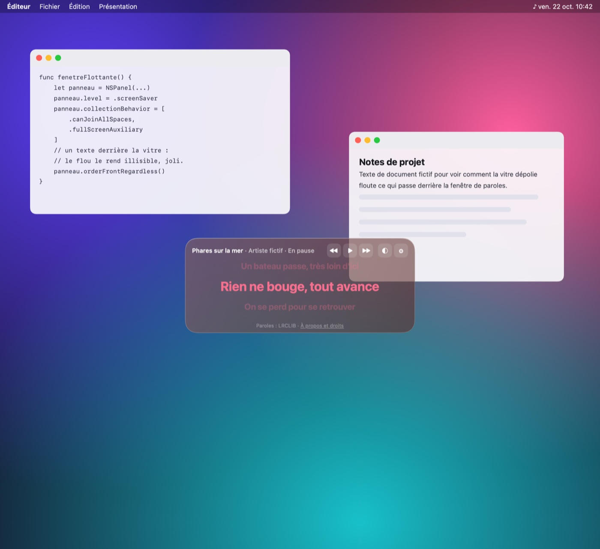

> Les captures de ce README sont des rendus faits par l'app elle-même (`--snapshot`) sur un faux bureau dessiné, avec des paroles, titres, artistes et pochettes **inventés**. Dans la vraie app, le verre dépoli floute ce qui se trouve derrière la fenêtre ; ces rendus ne montrent pas ce flou.
> L'interface de l'app est **en français** dans cette version (menus, réglages, messages).

## Ce que ça fait

Lance un morceau dans Spotify ou Apple Music (l'app Musique). Lyra Lyrics le repère, cherche les paroles sur [LRCLIB](https://lrclib.net) et en affiche une, trois ou cinq lignes dans une petite fenêtre qui reste au-dessus de toutes les autres, où tu veux sur l'écran. La ligne chantée est mise en avant et glisse en douceur à sa place au fil du morceau.

Pas de compte, pas de connexion, pas de serveur à nous : l'app parle à ton lecteur de musique et à lrclib.net, rien d'autre.

## Fonctions

- **Toujours au-dessus**, déplaçable n'importe où, y compris au-dessus des fenêtres d'autres apps (voir [l'icône du Dock et le plein écran](#licône-du-dock-et-le-plein-écran)). **Redimensionnable à la souris** : tire un bord ou un coin (zone de prise de 6 pt, 280 × 110 pt au minimum, 90 % de l'écran visible au maximum) ; le texte **s'adapte automatiquement** : la taille de police est la plus grande pour laquelle les lignes visibles tiennent dans la fenêtre en largeur et en hauteur (le réglage « Taille max » est la limite haute) : fenêtre plus grande, texte plus grand. Une ligne ne passe à la ligne que si elle ne tient pas, même à 14 pt. La taille est retenue ; « Taille par défaut » dans les réglages la réinitialise. Désactivé en mode clic-à-travers.
- **Défilement doux** façon Apple Music : à chaque changement de ligne, les lignes glissent vers le haut, la nouvelle ligne courante grossit un peu et s'éclaircit, les voisines s'estompent et prennent un léger flou. Fait avec des animations de couches Core Animation (aucun redessin à chaque image), fluide à 60 et 120 Hz ; avec « Réduire les animations », un simple fondu remplace le glissement.
- **Couleurs de la pochette** (activé par défaut, désactivable) : la teinte du fond et la couleur de la ligne courante viennent de la pochette du morceau en cours, avec un contraste d'au moins 4,5 : 1 pour la ligne courante contre la teinte. Apple Music : la pochette est lue dans l'app Musique. Spotify : la pochette est téléchargée une fois par morceau (voir [Vie privée](#vie-privée)). Désactivé, ou sans pochette : les styles unis.
- **Boutons de lecture** dans la barre qui apparaît au survol : précédent, lecture/pause, suivant, pour le lecteur en cours. Si macOS n'a pas encore été interrogé, le premier clic demande l'autorisation Automatisation (une phrase d'explication apparaît dans la fenêtre, puis l'invite du système) et envoie ensuite la commande ; si tu l'as refusée, les boutons restent grisés et un clic propose « Ouvrir les Réglages » (rien n'est jamais demandé deux fois).
- **Une, trois ou cinq lignes** (réglage « Lignes ») ; la hauteur de la fenêtre s'adapte, les lignes longues passent toujours à la ligne et réduisent la police au besoin.
- **Thèmes de police** : Classique, Élégant (serif New York), Néon (arrondie grasse avec halo), Minimal (fine), chacun règle police, graisse, couleur, halo et taille des voisines d'un clic. Modifier ensuite un seul réglage affiche « Personnalisé ».
- **Paroles synchronisées** : ligne courante mise en avant, voisines atténuées. Quand LRCLIB n'a que du texte brut, il s'affiche en bloc qui défile lentement, avec la mention « non synchronisées ».
- **Trois fonds** : uni, verre dépoli, transparent (texte avec une ombre douce).
- **Réglages** : police, graisse, taille max, couleur du texte, halo, opacité du fond.
- **Décalage manuel** de −5 s à +5 s, pour le titre en cours seulement, quand des paroles sont un peu en avance ou en retard.
- **Mode clic-à-travers** : les clics traversent la fenêtre vers l'app dessous. L'activer ferme le volet de réglages et un avis de 3 secondes dans la fenêtre rappelle comment revenir. Pour en sortir, appuie sur le raccourci (voir [Raccourci clavier](#raccourci-clavier)) : il désactive le clic-à-travers et montre la fenêtre. L'icône de la barre de menus marche aussi, mais sur un MacBook à encoche elle peut être cachée derrière l'encoche quand la barre est pleine ; le raccourci est le chemin de retour.
- **Raccourci global** : ⌃⌥⌘L par défaut, modifiable dans les réglages.
- **Icône dans la barre de menus**, icône du Dock facultative (décochée par défaut).
- Bouton **« Vider le cache »**, et un message clair pour chaque situation : rien en lecture, recherche, pas de paroles, instrumental, service occupé, hors connexion, autorisation nécessaire, titre illisible.
- **Accessibilité** : libellés VoiceOver (boutons de lecture compris) ; « Réduire les animations » et « Réduire la transparence » de macOS sont respectés.
- **Sobre en énergie** : mesuré (3 passages de 60 s, `ps`) à 0,2 à 0,3 % de processeur en moyenne avec une ou trois lignes de paroles synchronisées et 0,4 à 0,5 % avec cinq lignes (95e centile : 2,3 % au plus), et environ 0 % quand la fenêtre est cachée ou qu'aucun lecteur ne tourne (un Mac, lecteur simulé, build debug, processus de l'app seulement, voir [Limites connues](#limites-connues)).

| Couleurs de la pochette (deux pochettes) | |
|---|---|
| 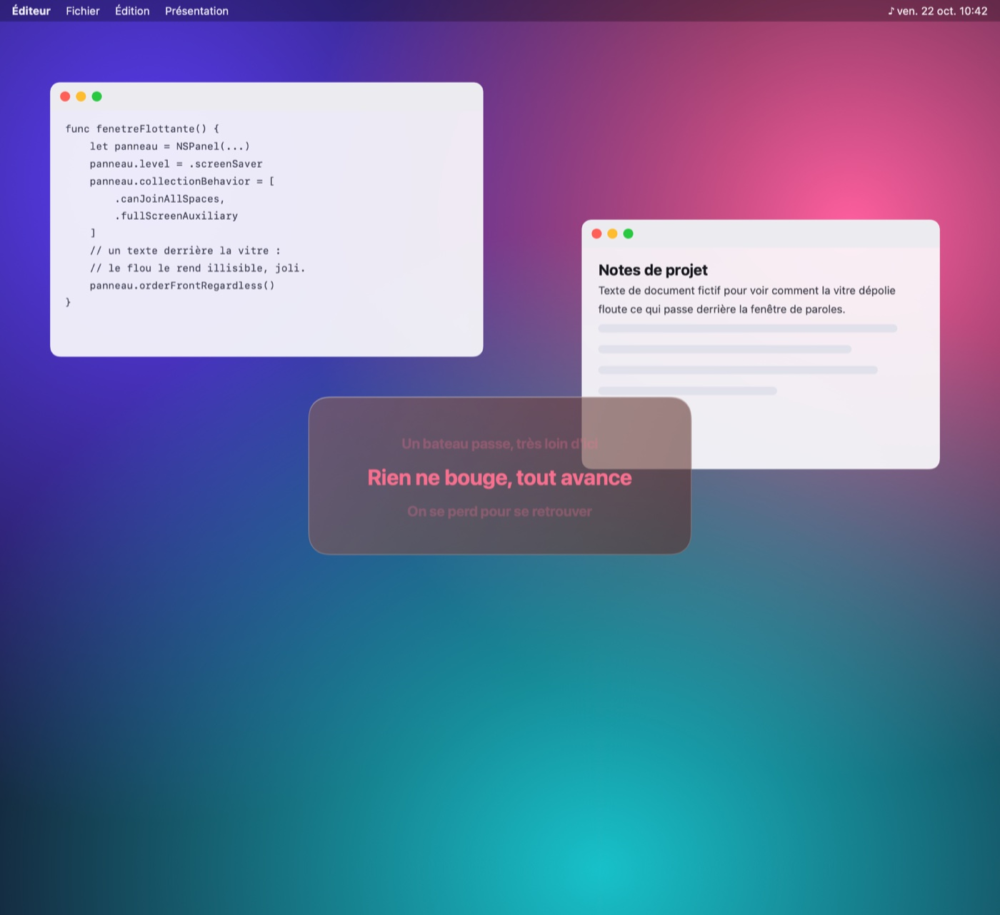 | 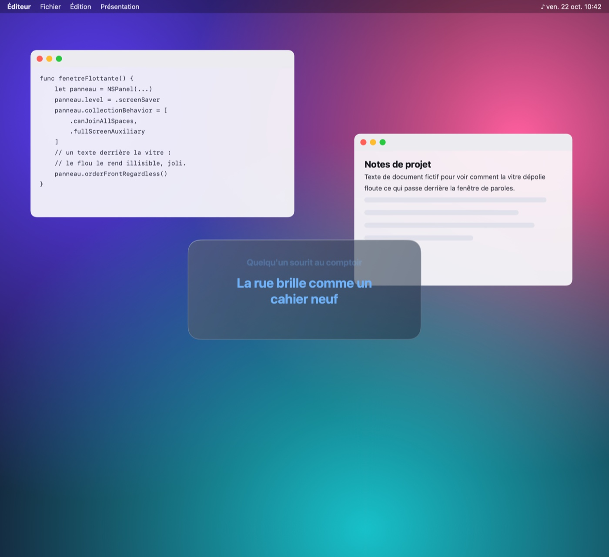 |

| Une ligne | Cinq lignes |
|---|---|
| 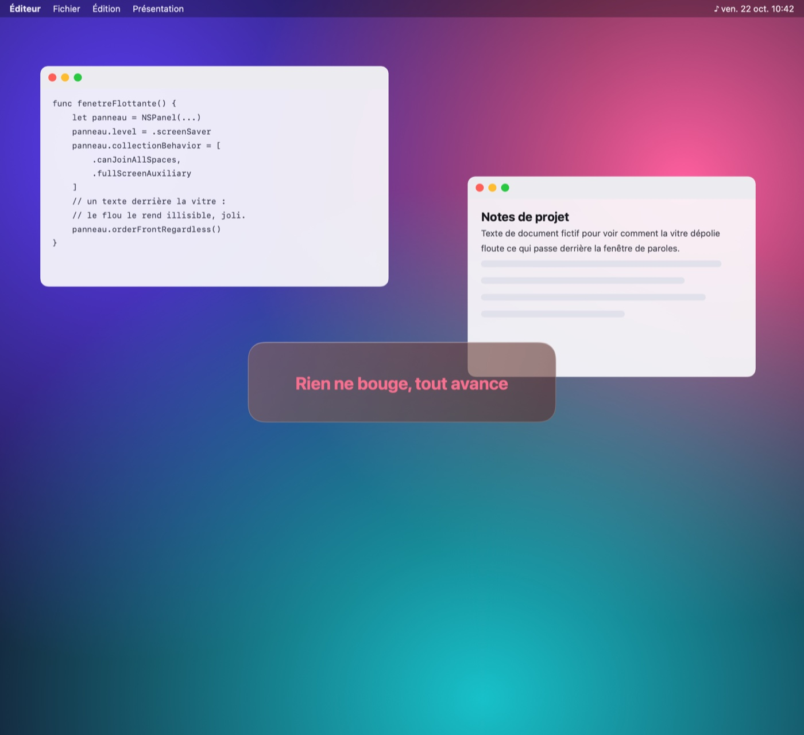 | 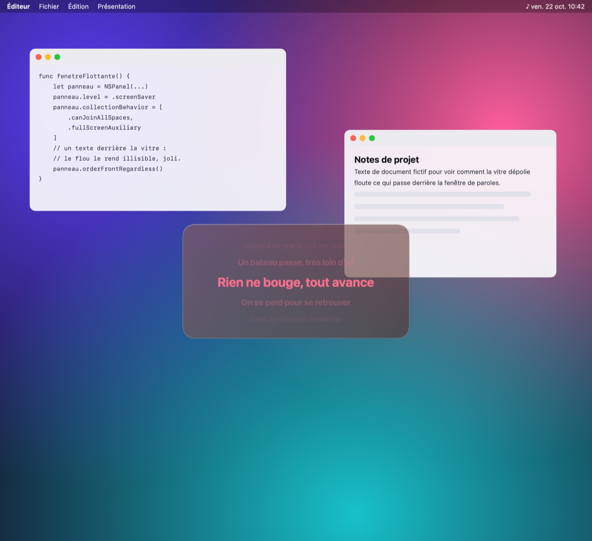 |

| Élégant | Néon | Minimal |
|---|---|---|
|  | 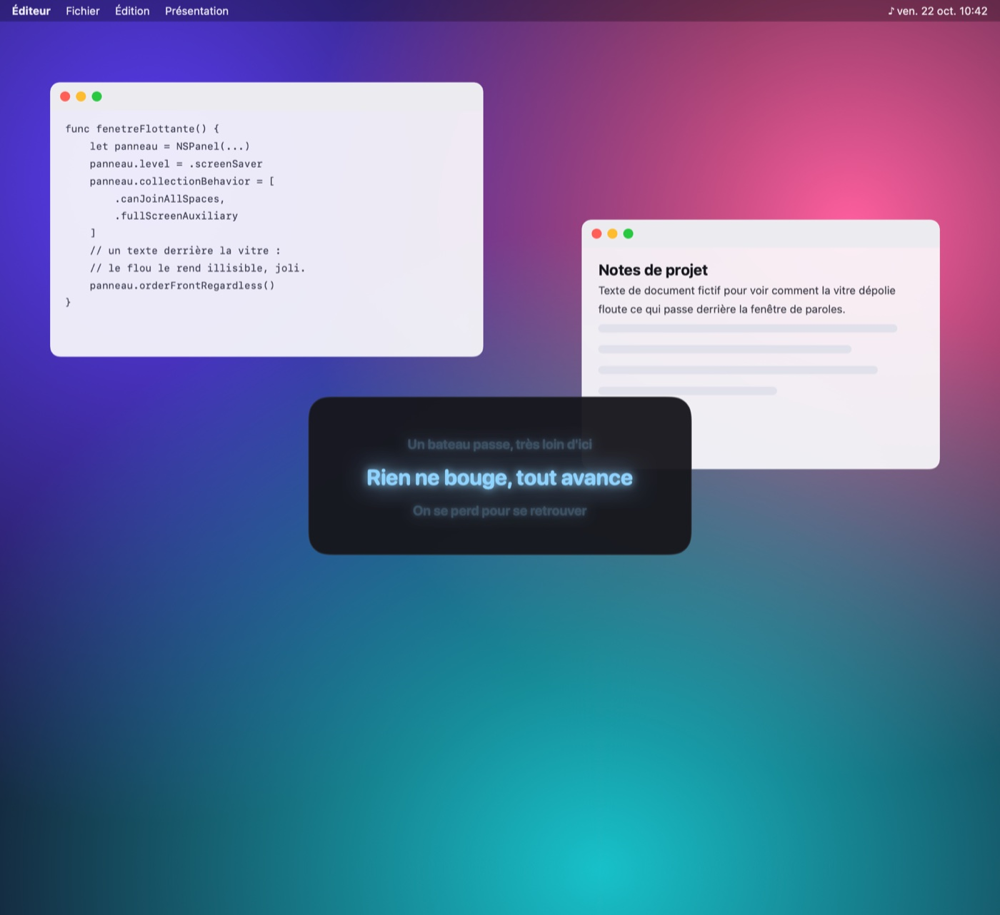 | 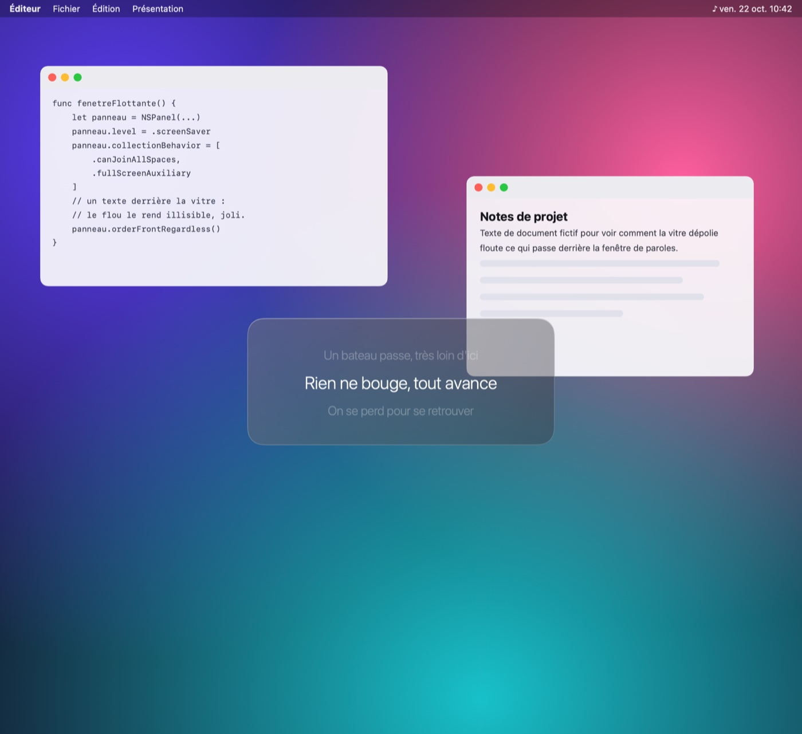 |

| Fenêtre redimensionnée : le texte suit | |
|---|---|
| 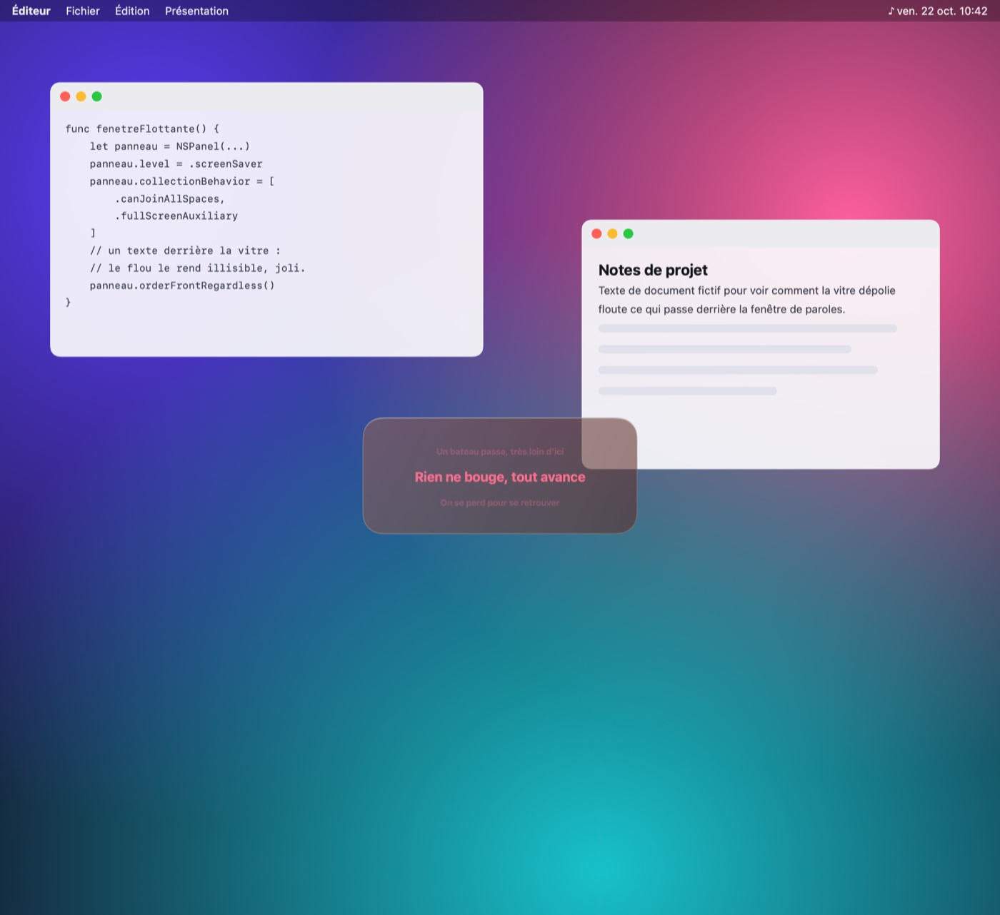 | 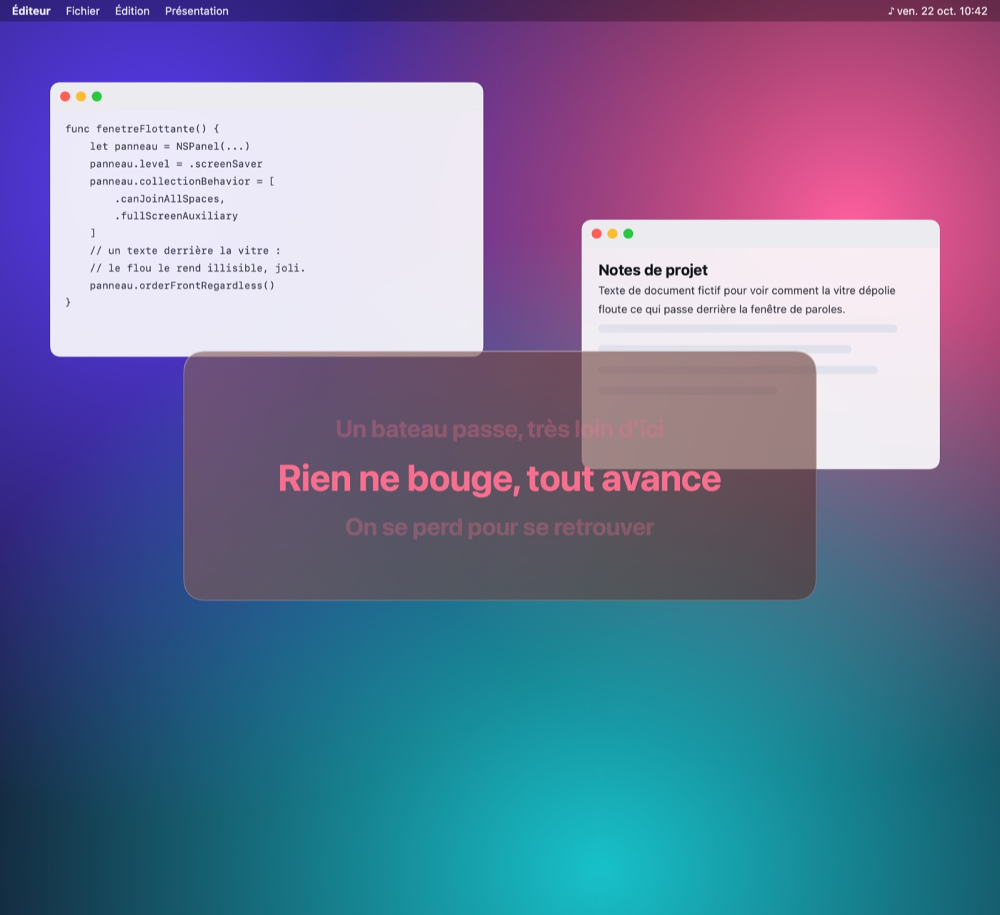 |

| Uni | Transparent (sur un bureau clair) |
|---|---|
|  | 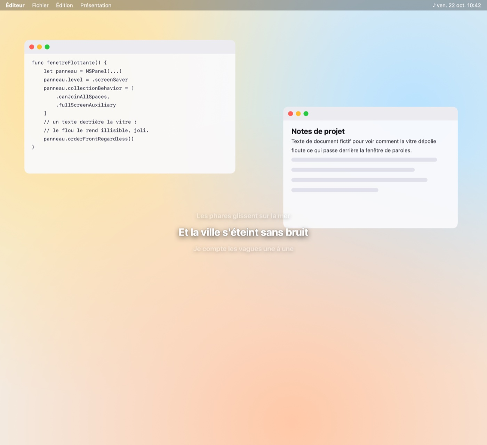 |

| Volet de réglages | Paroles sans synchronisation |
|---|---|
| 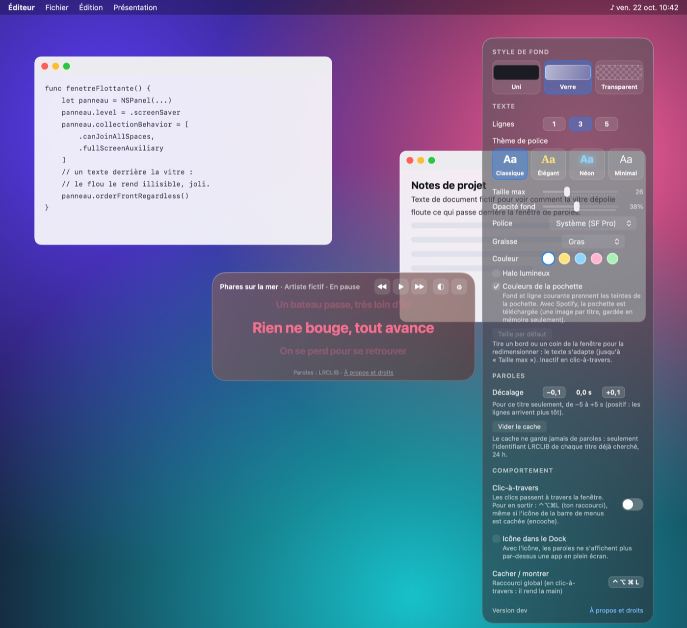 | 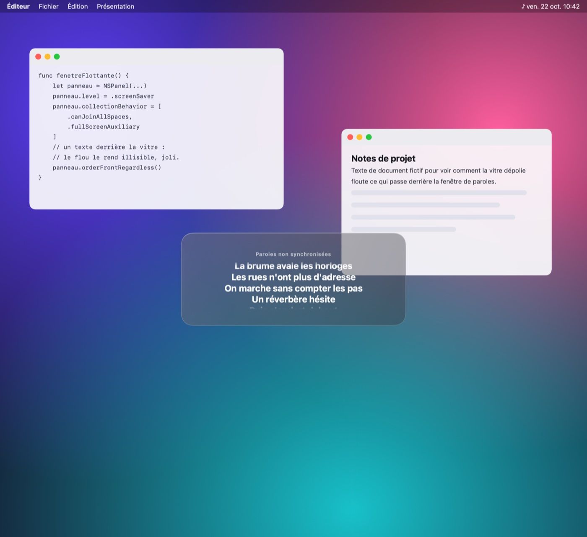 |

## Prérequis

- Un Mac **Apple silicon** sous **macOS 26 ou plus récent**. L'app publiée est un binaire `arm64` seulement (vérifié avec `lipo -info` : « Non-fat file ... architecture: arm64 »). Les Mac Intel ne sont pas pris en charge par le téléchargement ; compiler depuis les sources sur Intel n'a pas été essayé.
- Spotify (app de bureau) et/ou Apple Music (l'app Musique).
- Développée et testée sous macOS 27 ; macOS 26 lui-même n'a pas été testé.

## Installation

1. Télécharge `Lyra-Lyrics-1.0.1-macOS.zip` sur la [page des Releases](https://github.com/MalikChopa/lyra-lyrics/releases) et décompresse-le.
2. Glisse **Lyra Lyrics.app** dans ton dossier **Applications**.
3. Ouvre-la. La première fois, macOS la **bloque** (« Apple n'a pas pu vérifier... »). C'est normal : l'app n'est **pas notariée** par Apple (la notarisation demande un compte développeur payant, et ce projet est gratuit et fait sur le temps libre). Pour l'autoriser :
   - ouvre **Réglages Système > Confidentialité et sécurité**,
   - descends jusqu'au message qui parle de « Lyra Lyrics » et clique sur **Ouvrir quand même**,
   - confirme avec ton mot de passe ou Touch ID, puis rouvre l'app.

   Le texte exact de ces écrans peut différer selon ta version de macOS. Le clic droit > Ouvrir ne suffit plus sur les versions récentes de macOS.
4. Une icône en forme de note de musique apparaît dans la barre de menus, et une fenêtre « Rien en lecture » s'affiche. Lance un morceau.

Le SHA-256 de chaque zip est dans les notes de version : compare-le avec `shasum -a 256 Lyra-Lyrics-1.0.1-macOS.zip` si tu veux vérifier ton téléchargement.

Si tu préfères ne pas faire confiance à un binaire, [compile-la toi-même](#compiler-depuis-les-sources).

## Autorisations

Lyra Lyrics ne demande jamais Accessibilité, Surveillance de l'entrée ni Enregistrement de l'écran. Elle utilise seulement **Automatisation** (macOS la demande quand tu cliques sur le bouton ; tu peux la changer ensuite dans Réglages Système > Confidentialité et sécurité > Automatisation) :

- **Apple Music : obligatoire.** La seule façon de lire la position de lecture est d'interroger l'app Musique. La fenêtre affiche « Autorisation nécessaire » avec un bouton ; le système montre alors son invite. Si tu refuses, le même bouton ouvre les réglages.
- **Spotify : facultative.** Les changements de morceau arrivent par une notification que Spotify diffuse, sans permission. Une ligne du volet de réglages (« Améliorer la précision ») permet d'autoriser la lecture de la position dans Spotify, ce qui garde la ligne mise en avant juste après une pause ou un saut. Sans elle, les paroles s'affichent quand même, mais la synchro est moins précise.

L'app lit le titre, l'artiste, l'album, la durée et la position du morceau en cours, et (pour les couleurs) sa pochette. Elle ne pilote la lecture que quand **tu cliques** sur l'un des trois boutons de lecture (précédent, lecture/pause, suivant) ; elle a besoin pour cela de la même autorisation Automatisation, et ne la demande jamais d'elle-même.

## Vie privée

- **Ce qui sort de ton Mac.** Pour trouver les paroles, le titre, l'artiste, l'album et la durée du morceau en cours sont envoyés à lrclib.net (avec ton adresse IP, comme toute requête web). La requête porte aussi le nom de l'app, sa version et l'adresse du projet dans l'en-tête `User-Agent` (`LyraLyrics/1.0.0 (+https://github.com/MalikChopa/lyra-lyrics)`). **Une requête de plus, seulement pour Spotify et seulement si « Couleurs de la pochette » est activé :** la pochette du morceau est téléchargée une fois depuis le serveur d'images de Spotify (`i.scdn.co`), gardée en mémoire seulement, jamais écrite sur le disque, et annulée si le morceau change avant la fin. Les pochettes d'Apple Music sont lues dans l'app Musique, sans téléchargement. Désactive le réglage et plus aucune requête de pochette n'est faite. Rien d'autre ne quitte ton Mac : ni statistiques, ni télémétrie, ni rapport de plantage, ni vérification de mises à jour.
- **Les paroles ne sont jamais stockées.** Elles restent en mémoire pour le morceau affiché (et le précédent) et disparaissent quand tu quittes. Pas de cache HTTP, pas de fonction copier ou exporter.
- **Ce qui est sur le disque.** Tes réglages, et un petit index de recherche dans `~/Library/Application Support/io.github.malikmoussaoui.lyra-lyrics/` : une empreinte salée de (titre, artiste, durée) associée à l'identifiant LRCLIB, pendant 24 h et 500 entrées au plus. Il ne contient aucun texte. « Vider le cache » le vide. Cette empreinte est un simple brouillage, pas une protection.
- **Seul le morceau en cours** est cherché, quand il démarre : pas de préchargement, pas d'historique.
- Cela décrit ce que le code est conçu et testé pour faire (le binaire publié ne contient aucune adresse autre que lrclib.net, ce dépôt et l'hôte d'images de Spotify `i.scdn.co`). Ce n'est pas un avis juridique.

## L'icône du Dock et le plein écran

macOS ne laisse une fenêtre flotter au-dessus d'une app en plein écran que si l'app n'a **pas d'icône dans le Dock**. C'est pourquoi l'icône du Dock est **décochée par défaut** (« Icône dans le Dock » dans les réglages). Si tu l'actives, la fenêtre de paroles ne s'affiche plus au-dessus d'une app en plein écran (elle reste au-dessus des fenêtres normales). À toi de choisir ce qui compte le plus.

## Raccourci clavier

**⌃⌥⌘L** (Contrôle, Option, Commande, L) cache ou montre la fenêtre. **En mode clic-à-travers, il fait autre chose :** il désactive le clic-à-travers et montre la fenêtre (il ne la cache jamais), parce que dans ce mode la fenêtre ne reçoit plus aucun clic et que tu ne pourrais pas ouvrir les réglages ; et sur un MacBook à encoche, l'icône de la barre de menus peut être cachée derrière l'encoche quand la barre est pleine. Clic-à-travers désactivé, il cache ou montre comme d'habitude. Relancer l'app (Spotlight, Finder) sort aussi du clic-à-travers. Il se change dans le volet de réglages (bouton ⚙ de la fenêtre, visible quand le pointeur la survole). Si le système ne peut pas enregistrer la combinaison, le volet affiche « raccourci indisponible » et l'ancienne reste active.

## Compiler depuis les sources

Il te faut seulement les **Command Line Tools** de Xcode (pas Xcode complet) avec Swift 6, sous macOS 26 ou plus récent. Aucune dépendance n'est téléchargée.

```sh
git clone https://github.com/MalikChopa/lyra-lyrics.git
cd lyra-lyrics
swift build                 # build debug de toutes les cibles
scripts/test.sh             # tests unitaires (Swift Testing) ; la dernière ligne dit quel chemin a servi
scripts/bundle.sh           # build release -> .build/bundle/LyraLyrics.app
scripts/package.sh          # zip -> .build/dist/Lyra-Lyrics-<version>-macOS.zip, avec son SHA-256
```

- **Signature** : `scripts/bundle.sh` signe avec le premier certificat local de signature de code qu'il trouve dans ton trousseau, en cherchant `PF_SIGN_IDENTITY` (si tu la définis) puis « Lyra Lyrics Code », et affiche lequel il a utilisé ; il **retombe sur une signature ad hoc** s'il n'en existe aucun. C'est suffisant pour l'utiliser chez toi, mais avec une signature ad hoc macOS peut redemander l'autorisation Automatisation après chaque recompilation.
- **Renommer l'app** : modifie la seule ligne `displayName` de `Sources/LyricsCore/AppIdentity.swift` ; l'identifiant de bundle est dans `Resources/Info.plist` et `scripts/bundle.sh`.
- Le build debug a des drapeaux de ligne de commande pour les tests (faux lecteur, faux serveur LRCLIB, `--snapshot`) ; le build release ne les contient pas. Voir `scripts/run-app-test.sh` et `Fixtures/selftests/`. Les commentaires du code sont en français.
- `scripts/ear-check.sh` aide à vérifier la synchro à l'oreille sur Spotify.

## Limites connues

- **Morceaux en streaming dans Apple Music : non vérifié.** On n'a pas établi si Musique donne une position utilisable pour les titres lus depuis le catalogue (et non depuis ta bibliothèque) ; la synchro peut manquer ou être décalée pour eux.
- **Spotify : lire sa position demande l'autorisation Automatisation** (voir plus haut) ; sans elle, l'app suit seulement les changements de morceau.
- **Couleurs de la pochette : non vérifiées avec une vraie pochette.** Elles ont été testées avec des images inventées (chemin Apple Music, et chemin Spotify contre un serveur de test local). L'hôte d'images de Spotify (`i.scdn.co`) et les Apple events qui lisent la pochette et pilotent la lecture viennent des dictionnaires de script des apps et n'ont pas été essayés sur un vrai lecteur. Le contraste de 4,5 : 1 est calculé contre la teinte comme une couleur opaque ; sur les styles verre et transparent, le vrai fond derrière la fenêtre est inconnu.
- **Boutons de lecture et invite d'autorisation depuis les boutons : non vérifiés sur un vrai lecteur** (testés avec une autorisation et un envoi simulés ; la vraie invite et les vrais Apple events restent à vérifier à la main).
- **Redimensionnement** : la forme du curseur sur les zones de prise et un vrai glissement à la souris n'ont pas été vérifiés à l'écran (l'essai automatique envoie des événements souris synthétiques).
- **Texte brut** (non synchronisé) : il défile en bloc, ce qui coûte environ 2 % de processeur pendant le défilement.
- **Disponibilité de LRCLIB.** Le service est communautaire et gratuit : il répond parfois « occupé » (HTTP 503, mesuré sur 7 titres connus sur 22 à la première demande) ou n'a pas de paroles pour un titre. Depuis la 1.0.1, une requête en échec passe tout de suite à la recherche et l'app réessaie seule (« Service de paroles occupé », avec compte à rebours et bouton **Réessayer**) ; « Paroles indisponibles » veut maintenant dire que LRCLIB n'a vraiment rien.
- **Interface en français seulement** ; **Apple silicon seulement** ; **macOS 26 ou plus seulement** ; pas encore de version Windows.
- **Niveau de test** : la logique est couverte par des tests unitaires et par des essais automatiques avec un lecteur et un serveur simulés. Les vrais lecteurs ont été essayés sur un seul Mac (macOS 27). La synchro a été vérifiée **à l'oreille** sur Spotify par l'auteur, sans mesure chiffrée. Les chiffres de processeur viennent d'un lecteur simulé sur un Mac.
- Non notariée : macOS te demande de confirmer le premier lancement.

## Crédits et droits

- Les paroles viennent de **[LRCLIB](https://lrclib.net)**, base communautaire. Lyra Lyrics est une app indépendante, **non affiliée** à LRCLIB, Spotify ou Apple.
- **Les paroles appartiennent à leurs auteurs et éditeurs.** Elles sont affichées ici pour un **usage personnel**, seulement pour le morceau que tu écoutes ; l'app ne les stocke jamais sur le disque, ne les envoie nulle part et ne les redistribue pas. Si tu trouves un problème avec des paroles, signale-le à LRCLIB.
- L'icône de l'app est dessinée par du code (voir `scripts/make-icon-proposals.swift`) ; aucun visuel n'a été copié.

## Licence

[MIT](LICENSE), Copyright (c) 2026 Chopa. Voir aussi le [journal des versions](CHANGELOG.md) (en anglais).
